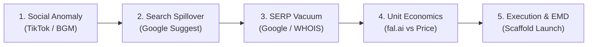

# Viral Keyword Hunter & Trend-Jacking Runbook

This skill equips the agent to identify, validate, and quantify sudden viral meme and AI video keywords within their golden 48–72 hour window, preventing wasted development on flat trends and ensuring high-converting, profitable site launches.

For the complete technical doctrine, algorithms, and deep rationale, refer to:
[Viral Keyword Analysis SOP](./references/sop.md)

---

## 1. When to Activate This Skill

Activate this workflow whenever:
* The user asks to **find, discover, or recommend new viral keywords** (e.g. "找新词", "爆款新词", "今年能抓住多少波行情").
* The user proposes a specific trend, sound, or meme (e.g., "ai hug video", "hit the road dude") and wants to know if it is commercially viable.
* The user wants to analyze competitor rankings, SERP competition, or domain availability for an emerging AI meme keyword.

---

## 2. Five-Phase Analysis Pipeline



### Phase 1: Social Anomaly Detection (T+0 to T+24h)
1. **Target Platforms**:
   * **TikTok Creative Center** (`ads.tiktok.com/business/creativecenter`): Trending Songs (Popular Sounds in US/UK/CA/AU), Trending Hashtags.
   * **Know Your Meme** (`knowyourmeme.com`): Meme lore, original creator, meme format taxonomy.
   * **Instagram Reels Audio**: Fast-rising audio tracks with >10,000 remixes in <48 hours.
2. **Qualification Threshold**:
   * **Creation Friction Paradox**: The trend *must* require complex editing, AI face swap, character insertion, or voice synthesis that standard mobile apps cannot do in one click.
   * **Comments Intent**: High density of questions like *"What app is this?"*, *"How to make this video?"*, *"Name of AI?"*.

---

### Phase 2: Search Spillover Verification
Verify whether social viewers are actively converting into Google searchers:

1. **Run Intent & Suggestion Script**:
   Execute the automated intent scanner:
   ```bash
   python3 scripts/check_google_suggest.py "<candidate keyword>"
   ```
2. **Evaluate Output**:
   * ✅ **Positive Signal**: Suggestions auto-complete with `ai`, `generator`, `template`, `app`, `filter`.
   * ❌ **Negative Signal**: Only entertainment queries (`lyrics`, `original sound`, `who is`) without tool intent.

---

### Phase 3: SERP Vacuum & Competitor Auditing
Measure how crowded the first page of Google is:

1. **SERP Inspection**:
   Search Google for `"<keyword> ai"` and `"<keyword> generator"`:
   * **Tier 1 Vacuum (Golden Window)**: Page 1 contains only TikTok video links, Reddit threads, and YouTube shorts. Zero dedicated web tools.
   * **Tier 2 Vacuum (Viable Race)**: 1–2 fledgling independent tools present, registered within the past 14 days.
   * **Saturated**: Entrenched big SaaS platforms (CapCut, Canva, Luma, Runway) dominate with dedicated landing pages.
2. **Domain & EMD Scanning**:
   Run the EMD availability script:
   ```bash
   python3 scripts/check_emd_whois.py "<candidate keyword>"
   ```
   * Priority TLDs: `.space` ($1.18), `.top`, `.com`, `.org`, `.fun`.

---

### Phase 4: Unit Economics & Feasibility
Ensure the keyword has high gross margin potential:

$$\text{Gross Margin} = \frac{\text{Tier Price} - (\text{Inference Cost} + \text{Payment Fee})}{\text{Tier Price}} \ge 80\%$$

* **Target Pricing Architecture**:
  * Solo Pack: \$4.99 ~ \$6.99 (1 video credit)
  * Trio Pack: \$12.99 ~ \$14.99 (3 video credits) — *Anchor Tier*
  * Crew Pack: \$19.99 ~ \$24.99 (5-8 video credits)
* **Model Inference Feasibility**:
  * Face Swap: InstantID / ReActor / FaceFusion (~$0.05 - $0.15/run)
  * Image-to-Video: Kling / fal.ai LTX / Runway (~$0.20 - $0.40/10s)
  * Expected render duration: 60 - 90 seconds.

---

### Phase 5: Fast Scaffold Deployment
When a keyword scores $\ge 80/100$:
* Clone or configure the reusable scaffold at:
  `/Users/uu66/Documents/antigravity/seo-game-website/scaffold-viral-ai-meme`
* Update branding, metadata, structured schema, and sample videos in `site.config.ts`.
* Connect Vercel deployment with built-in analytics, waitlist, and Stripe.

---

## 3. Decision Matrix & Scoring Rubric

Score each proposed keyword out of 100 points:

| Evaluation Dimension | Weight | Full Score Criteria |
| :--- | :---: | :--- |
| **Search Spillover Ratio** | 30 pts | Google Suggest auto-completes with `ai` / `generator`; Google Trends shows Breakout (>5000%). |
| **Creation Friction** | 25 pts | Requires AI multi-step synthesis (cannot be done via native TikTok filter). |
| **SERP Vacuum** | 25 pts | Top 10 results lack dedicated SaaS; EMD domain available for <$5. |
| **Commercial Unit Margin** | 20 pts | Single-pack revenue $\ge \$5.00$ with GPU inference cost $\le \$0.40$ (Margin > 85%). |

* **Total $\ge 80$**: 🟢 **IMMEDIATE GREEN LIGHT**. Deploy site within 2 hours.
* **Total 60–79**: 🟡 **WATCHLIST**. Set up waitlist capture or monitoring.
* **Total < 60**: 🔴 **PASS**. Too competitive or lacks search intent.

---

## 4. Standard Response Template for User Queries

When analyzing keywords for the user, deliver findings using this structured markdown format:

```markdown
### 🎯 Keyword Candidate: [Keyword]
- **Trend Origin**: [Meme source / TikTok sound / First appearance date]
- **Opportunity Score**: [XX / 100] (Green / Yellow / Red)

#### 1. Search Spillover & Intent Analysis
- **Core Suggestion Query**: [Suggest results]
- **Google Trends Trajectory**: [Spike / Growth / Decaying]
- **Creation Friction Level**: [High / Medium / Low]

#### 2. SERP Competition & EMD Status
- **Google Top 10 Dominance**: [Social links only / 1 competitor / Saturated]
- **Domain Availability**: [.space / .com / .org]

#### 3. Unit Economics & Pricing Model
- **Estimated API Cost**: $[X.XX] per generation
- **Recommended Price**: $[X.XX] (Gross Margin: XX%)

#### 4. Action Recommendation
- [ ] Action item 1 (e.g. Register EMD)
- [ ] Action item 2 (e.g. Deploy scaffold with 3 free credits waitlist)
```
