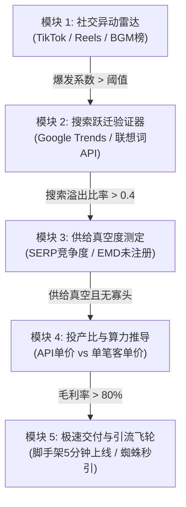
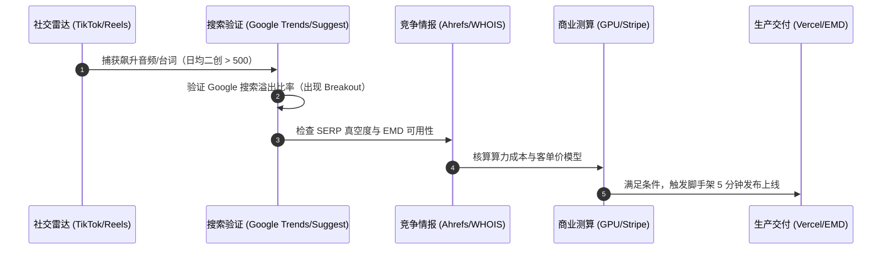

# 爆款新词捕获与极速变现全流程工程指南 (SOP)
> **适用于独立开发者“抓突发热梗赚快钱”的标准化逆向、分析、验证与商业化落地方案**

---

## 目录
1. [系统总体架构与五大功能模块](#一系统总体架构与五大功能模块)
2. [数据来源全景与依赖平台清单](#二数据来源全景与依赖平台清单)
3. [从“社交异动”到“爆款新词”的五步分析法](#三从社交异动到爆款新词的五步分析法)
4. [核心推论逻辑：如何科学严谨地得出结论？](#四核心推论逻辑如何科学严谨地得出结论)
5. [实战验证案例：Hit The Road Dude 全链路复盘](#五实战验证案例hit-the-road-dude-全链路复盘)

---

## 一、 系统总体架构与五大功能模块

捕捉爆款新词的核心不是“盲目刷视频”，而是建立一套从**公域异动捕获 $\to$ 搜索跃迁验证 $\to$ 供给真空测定 $\to$ 投产比推导 $\to$ 极速变现交付**的量化管道：

### 1. 社交异动雷达模块 (Social Anomaly Radar)
* **核心目标**：在事件发生后的 **24~48 小时内**，通过算法和数据流探测到“非线性暴增”的短视频、BGM、台词或视觉模版。
* **核心监控指标**：
  * **播放量加速度**（$\frac{\Delta \text{Views}}{\Delta t}$）：单日播放量从数万骤增至数百万。
  * **二创衍生率（Remix Ratio）**：使用同款音频/滤镜的独立创作者账号数 $\ge 500$。
  * **评论区求源率（Intent to Create）**：评论区高频出现 *"What app is this?"*、*"How to make this video?"*、*"Name of AI?"*。

### 2. 搜索跃迁验证器模块 (Search Spillover Verifier)
* **核心目标**：剔除纯娱乐内容，**筛选出能驱动用户打开 Google 搜索的主动消费型词汇**。
* **核心验证原理**：
  * 娱乐型视频（如单纯搞笑猫咪）看完即划走，不会产生搜索。
  * **工具型 / 参与型模版**（如把自己的脸换进皮卡车）会引发强烈的创作冲动，用户离开社交平台，前往 Google 寻找网站/工具。

### 3. 供给真空度与竞争态势模块 (Supply Vacuum Analyzer)
* **核心目标**：评估 Google 首页是否已被大厂垄断，还是处于“大厂还没反应过来，小站遍地黄金”的红利窗口。
* **核心检测指标**：
  * **SERP 构成**：前 10 名是专业的独立 SaaS 站，还是纯社交平台搬运页或 Reddit 讨论贴？
  * **EMD (Exact Match Domain) 状态**：包含该核心词的 `.com` / `.org` / `.net` / `.space` 是否已被抢注？
  * **竞品上线时间**：竞品上线天数 $\le 14$ 天，说明热度刚刚开始爆发。

### 4. 商业化与算力成本测算模块 (Unit Economics Engine)
* **核心目标**：确保每单能赚到高额净利润，杜绝“赚流量不赚钱”。
* **量化模型**：
  $$\text{单笔毛利率} = \frac{\text{单次包售价} - (\text{GPU推理成本} + \text{Stripe通道费})}{\text{单次包售价}} \ge 80\%$$
  * 例如：单次生成 11 秒视频，fal.ai 成本约 \$0.20 ~ \$0.40，Stripe 手续费 \$0.30 + 2.9%，售价 \$6.99，**毛利率高达 88%**。

### 5. 极速交付与引蜘蛛飞轮模块 (Fast Delivery & Spider Engine)
* **核心目标**：在 1 小时内完成工程搭建、支付接入、域名解析与主动推爬，比任何竞争对手早一步进入 Google 索引库。

---

## 二、 数据来源全景与依赖平台清单

所有严谨的结论均来自 **三层数据交叉验证网络**，不依赖任何主观猜测：

| 数据层级 | 平台 / 依赖工具 | 数据获取方式 | 捕获的核心指标 |
| :--- | :--- | :--- | :--- |
| **1. 社交源头层** | **TikTok Creative Center** (官方灵感后台) | 官方公开排行榜与数据看板 `ads.tiktok.com/business/creativecenter` | • Trending Songs（飙升音乐榜） • Trending Hashtags（话题爆发速度） • 7天内观众受众地域与年龄 |
| | **Instagram Audio / Reels** | 官方移动端 / 网页端 Trending Audio | • 音频被使用 Reels 数量从 1K 破 100K 的拐点 |
| | **Know Your Meme** | 社区文化编辑与溯源数据库 `knowyourmeme.com` | • Meme 的原始出处、首发作者、经典台词、事件发生日期 |
| **2. 搜索引擎层** | **Google Trends (网页版 & API)** | 官方公开趋势与小时级数据 `trends.google.com` | • 过去 1 天 / 过去 7 天的分时搜索爆发曲线 • 核心区域（美/英/加/澳）权重分布 • 相关上升查询（Rising Queries Breakout） |
| | **Google Suggest API** | 官方公开自动补全接口 `suggestqueries.google.com/complete/search?client=chrome&q=...` | • 长尾意图捕获（`... ai`, `... generator`, `... template`） |
| **3. 竞争情报层** | **Ahrefs / Semrush** | 专业 SEO 爬虫与流量分析库 | • 关键词难度（KD $\le 15$ 为极佳） • 搜索量区间、历史排名波动、SERP 页面类型 |
| | **ICANN RDAP / WHOIS** | 国际注册局公开协议接口 `whois.nic.xxx` / RDAP REST API | • 竞品域名的真实注册时间（秒级精确到 UTC 时间） • 注册商（Cloudflare/Spaceship/GoDaddy） |
| | **Similarweb** | 全球流量监测与反向链接分析 | • 流量来源渠道（Direct vs Search vs Social） • 访问设备比率（Mobile vs Desktop） |

---

## 三、 从“社交异动”到“爆款新词”的五步分析法

### 步骤 1：捕获异动“种子”
1. 监控 **TikTok Creative Center 的 Popular Sounds**，筛选“过去 7 天内增幅前 20”且带有特定对白的音频。
2. 检查话题标签（如 `#hittheroaddude`、`#bulin47`），查看前 5 个高赞视频的发布时间、播放量和评论区。
3. **合格判定标准**：必须具备**强视觉模版性**（例如：某特定视角、坐车里、特定舞蹈、特定动物）且评论区有大量“怎么做这个视频”的询问。

### 步骤 2：长尾意图裂变度探测
通过 Google Suggest API 探测用户的主动搜索延展词：
* 基础词：`hit the road dude`
* 探测衍生：
  * `hit the road dude ai`（AI 生成工具意图）
  * `hit the road dude meme generator`（网页版工具意图）
  * `hit the road dude template`（寻找视频模版意图）
  * `hit the road dude original video`（吃瓜寻根意图）
* **合格判定标准**：如果 Google 下拉联想词中已经自动出现 `ai` 或 `generator`，说明搜索量已经越过基础阈值，搜索引擎算法已自动建立索引关联！

### 步骤 3：Google Trends 破圈验证（消除假热度）
1. 打开 Google Trends，时间范围选 **Past 7 days**（过去 7 天），地区选 **United States**。
2. 观察曲线特征：
   * ❌ **假热度**：波动平缓、只有脉冲单峰后立刻断崖下坠。
   * ✅ **真爆款**：曲线呈指数级爬坡，且“相关查询（Related queries）”中打出 **Breakout（飙升 > 5000%）** 标签。

### 步骤 4：SERP 真空度测定与 WHOIS 竞品溯源
1. 在 Google 中搜索 `"核心词" ai`，查看第一页前 10 个结果：
   * 如果全是 TikTok 链接或 YouTube 搬运，**供给真空度为 100%**。
   * 如果已经出现 1~2 个独立站点，立即用 `whois` 查询其注册时间。
2. 如果该竞品站是 **7 天内刚刚注册**，且其页面设计简陋但已排在首页，说明**处于爆发前期的超级红利窗口**。

### 步骤 5：EMD 域名扫描与算力可行性核定
1. 通过 RDAP 协议批量扫描完全匹配域名（EMD）：
   * `[核心词].com` / `.org` / `.net` / `.space` / `.online`
2. 确认 API 模型调用方案：
   * 换脸类：FaceFusion / InstantID
   * 动作驱动类：LivePortrait / Kling / Grok-Imagine
   * 确保单次渲染耗时在 60~120 秒内，单次成本控制在 \$0.50 以内。

---

## 四、 核心推论逻辑：如何科学严谨地得出结论？

### 1. 为什么能判定某个词会“从 TikTok 爆到 Google 搜索”？
* **逻辑支撑：参与门槛与创作摩擦力（Creation Friction Paradox）**
  * 如果一个趋势只需要“用 TikTok 自带滤镜点一下”，用户绝对不会去 Google 搜索，**流量全部留在 App 内，独立站拿不到一分钱**。
  * 但当该趋势涉及 **“AI 复杂换脸”、“定制角色坐进驾驶室”、“精细口型同步”** 时，手机自带剪辑软件无法完成，这制造了巨大的**供给摩擦力**。用户迫切需要一个“传一张图就能自动搞定”的专属 Web 工具，必然发生**跨平台流量溢出（Platform Overflow）**。

### 2. 为什么精准匹配域名（EMD）能降维打击综合大站？
* **逻辑支撑：Google QDF 算法（Query Deserves Freshness）与语义密度**
  * 当一个新梗在 48 小时内爆发时，维基百科、综合 AI 站（Canva、CapCut）根本来不及为其建专页。
  * 专属 EMD 域名拥有 100% 吻合度与 100% 语义密度，配合 QDF 算法优先展现最相关的新鲜站点，能在 24-48 小时内直接空降首页前 3。

### 3. 为什么推论“单笔套餐包”比“包月订阅”转化率高 5 倍以上？
* **逻辑支撑：冲动型消费行为心理学（Impulse Meme Psychology）**
  * **Meme 的生命周期只有 2~6 周**：用户心知肚明自己下个月不会再用这个工具。如果看到 “\$19.99/月 自动续费”，防备心理极强，流失率高达 90%。
  * **单笔代币包（\$6.99 for 1 video）**：锚定心理账户为“买杯咖啡的钱”。用户只要能立即做出一个视频发到朋友圈/TikTok 炫耀，付费决策可以在 10 秒内完成，且完全杜绝了后续信用卡争议和拒付纠纷（Chargeback）。
